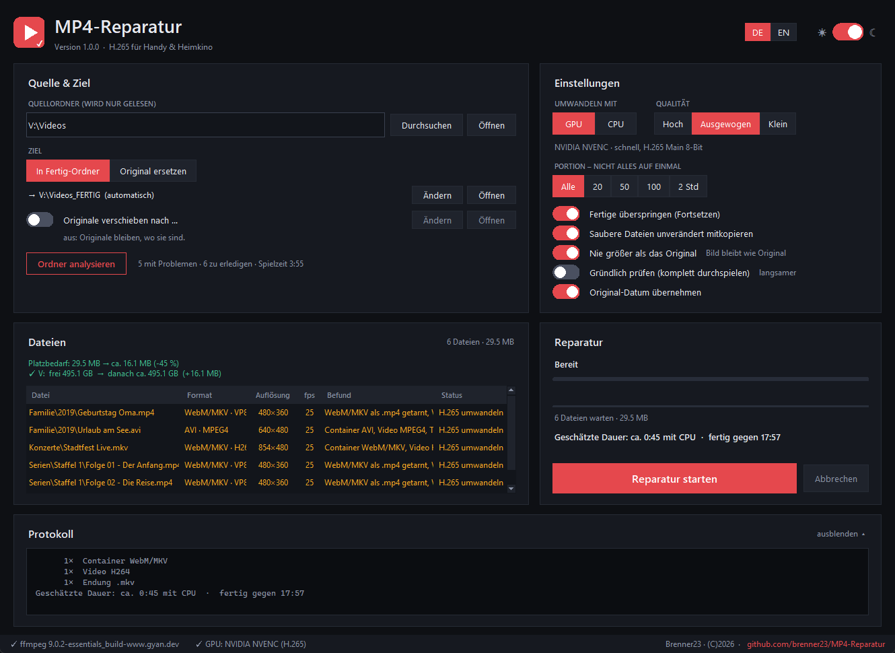
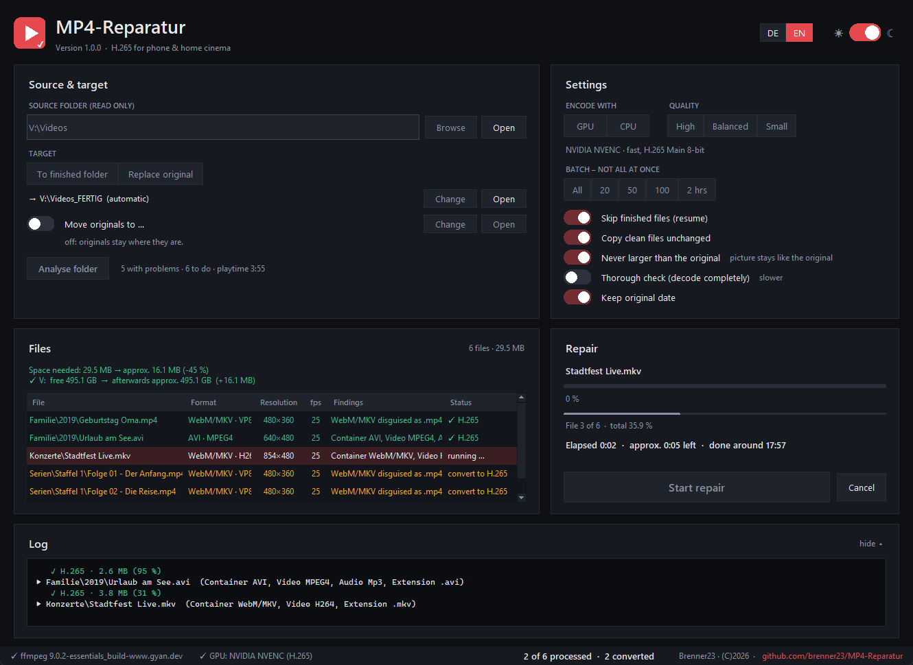
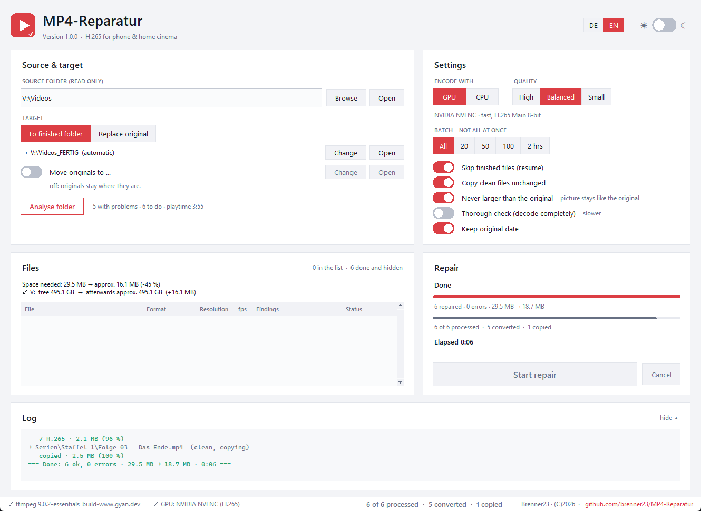

# MP4-Reparatur

**Videos, die auf dem Handy oder Fernseher ruckeln, in saubere H.265-MP4s verwandeln – ganze Ordner und Laufwerke auf einmal.**
*Turn videos that stutter on phones or TVs into clean H.265 MP4s – whole folders and drives at once.* → [English below](#english)

## Wofür?

Viele Videosammlungen enthalten Dateien, die zwar `.mp4` heißen, aber in Wahrheit etwas anderes sind –
z. B. alte YouTube-Downloads (WebM mit VP8/Vorbis), Rips als AVI (Xvid/DivX + MP3), MKV-Dateien oder Videos mit
schwankender Bildrate. Am PC laufen sie meist, auf Handy, Smart-TV oder per Streaming stottern sie.

MP4-Reparatur analysiert einen Ordner (oder ein ganzes Laufwerk / NAS), zeigt was nicht stimmt und macht daraus
**H.265 (HEVC Main, 8 Bit, `hvc1`) + AAC in MP4, mit fester Bildrate und `faststart`** – das läuft auf
iPhone, Android, Smart-TV, Plex/Jellyfin und im Browser.

## Funktionen

- **Analyse** per ffprobe: getarnte WebM/MKV, alte Codecs (VP8, MPEG-4, H.264 …), schwankende Bildrate, Ton ≠ AAC, falsche Endung
- **Zwei Arbeitsweisen**
  - *In Fertig-Ordner* (Standard): Ergebnisse nach `<Ordner>_FERTIG`, die Quelle wird nur gelesen
  - *Original ersetzen*: die neue Datei ersetzt das Original erst **nach bestandener Prüfung**;
    Originale werden nicht gelöscht, sondern verschoben (Standard `<Ordner>_ORIGINAL` oder z. B. auf eine andere Platte –
    die Ordnerstruktur wird in voller Tiefe nachgebaut)
- **GPU (NVIDIA NVENC)** oder **CPU (x265)**, drei Qualitätsstufen
- **Nie größer als das Original**: die Bitrate wird an der Quelle gedeckelt – keine Platte läuft über
- **Platzprognose** je Laufwerk nach der Analyse und **Platz-Wächter** vor jeder Datei (hält sauber an, bevor es eng wird)
- **Portionen** (20 / 50 / 100 Dateien oder 2 Stunden) mit „Weitermachen?“ – ideal für große NAS-Bestände
- **Fortsetzen**: bereits reparierte Dateien werden erkannt, es geht an der alten Stelle weiter;
  ein Analyse-Gedächtnis spart das erneute Einlesen unveränderter Dateien
- Zeitschätzung vorab, Restzeit und Endzeit live – lernt die Geschwindigkeit deines PCs mit
- Umgewandelt wird in einem lokalen Arbeitsordner, nie halb auf dem Netzlaufwerk
- Dunkel/Hell, **Deutsch/Englisch** umschaltbar

## Selbst bauen

Es werden **keine fertigen EXE-Dateien** veröffentlicht – du baust das Programm selbst. Das dauert etwa eine Minute.

1. [Python 3.9+](https://www.python.org/downloads/) installieren (beim Setup **„Add python.exe to PATH“** anhaken)
2. Dieses Repository herunterladen (*Code → Download ZIP*) und entpacken
3. `build.bat` doppelklicken

Ergebnis:

| Datei | Was |
|---|---|
| `dist\MP4-Reparatur\MP4-Reparatur.exe` | sofort startbar, ohne Installation (Ordner mit `_internal`) |
| `release\MP4-Reparatur_1.0.0_portable.zip` | derselbe Ordner als ZIP zum Weitergeben |
| `release\MP4-Reparatur_1.0.0_Setup.exe` | Installer – **nur wenn [Inno Setup](https://jrsoftware.org/isdl.php) installiert ist** (optional) |

`build.bat onefile` baut stattdessen eine einzelne EXE. Die ist bequemer, wird von Windows Defender / SmartScreen
aber häufiger als „unbekannt“ gemeldet – deshalb ist die Ordner-Variante der Standard.

Ohne Bauen geht es auch direkt: `python MP4-Reparatur.py` (nur Python nötig, keine weiteren Pakete).

### ffmpeg

ffmpeg ist **nicht** enthalten. Beim ersten Start lädt das Programm die aktuelle Version
([gyan.dev](https://www.gyan.dev/ffmpeg/builds/) „essentials“) nach `%LOCALAPPDATA%\MP4-Reparatur\bin`
und fragt bei späteren Starts, wenn es eine neuere gibt.

### Wo liegt was?

| Ordner | Inhalt |
|---|---|
| `%LOCALAPPDATA%\MP4-Reparatur\bin` | ffmpeg / ffprobe |
| `%USERPROFILE%\MP4-Reparatur` | Einstellungen, Analyse-Gedächtnis, Arbeitsordner |

Der Installer entfernt beide Ordner beim Deinstallieren wieder.

## Hinweise

- Jede Umwandlung ist eine Kopie einer Kopie: **besser als das Original wird es nicht**, bei „Ausgewogen“ und „Hoch“
  ist auf Handy und TV aber kein Unterschied zu sehen. Deshalb werden Originale verschoben, nie gelöscht.
- GPU-Umwandlung braucht eine NVIDIA-Karte ab GTX 10xx mit aktuellem Treiber; sonst wird automatisch die CPU genutzt.
- Nur Windows (getestet mit Windows 11).

## Lizenz

[MIT](LICENSE) © 2026 Brenner23 – erstellt mit Unterstützung von Claude (Anthropic).

**Drittsoftware:** [FFmpeg](https://ffmpeg.org) wird nicht mitgeliefert, sondern beim ersten Start separat geladen
und steht unter eigener Lizenz (GPL v3, siehe [ffmpeg.org/legal.html](https://ffmpeg.org/legal.html)).

---

## English

Many video collections contain files that are called `.mp4` but are really something else – old YouTube downloads
(WebM with VP8/Vorbis), AVI rips (Xvid/DivX + MP3), MKV files or videos with a variable frame rate. They play on a PC
but stutter on phones, smart TVs or when streaming.

MP4-Reparatur analyses a folder (or a whole drive / NAS), shows what is wrong and converts the files to
**H.265 (HEVC Main 8-bit, `hvc1`) + AAC in MP4 with a constant frame rate and `faststart`**.

**Features:** analysis with ffprobe · *to finished folder* or *replace original* (only after the new file has been
checked; originals are moved, never deleted, keeping the full folder structure – e.g. to another drive) ·
NVIDIA NVENC or x265 · *never larger than the original* · space forecast per drive and a space guard before every file ·
batches (20 / 50 / 100 files or 2 hours) · resume where you left off, analysis memory · time estimate, remaining time and
finish time · dark/light theme · German/English UI (switch at the top right).

**Build it yourself** (no EXE files are published): install [Python 3.9+](https://www.python.org/downloads/)
(tick *Add python.exe to PATH*), download this repository and double-click `build.bat`.
You get `dist\MP4-Reparatur\MP4-Reparatur.exe` (runs without installing), a portable ZIP and – only if
[Inno Setup](https://jrsoftware.org/isdl.php) is installed – an installer. `build.bat onefile` creates a single EXE,
which Windows SmartScreen flags more often. You can also just run `python MP4-Reparatur.py`.

ffmpeg is **not** included; it is downloaded on first start to `%LOCALAPPDATA%\MP4-Reparatur\bin`.
Settings live in `%USERPROFILE%\MP4-Reparatur`; the installer removes both folders on uninstall.

**Licence:** [MIT](LICENSE) © 2026 Brenner23 – made with help from Claude (Anthropic).
FFmpeg is not distributed with this software and is licensed separately (GPL v3).
